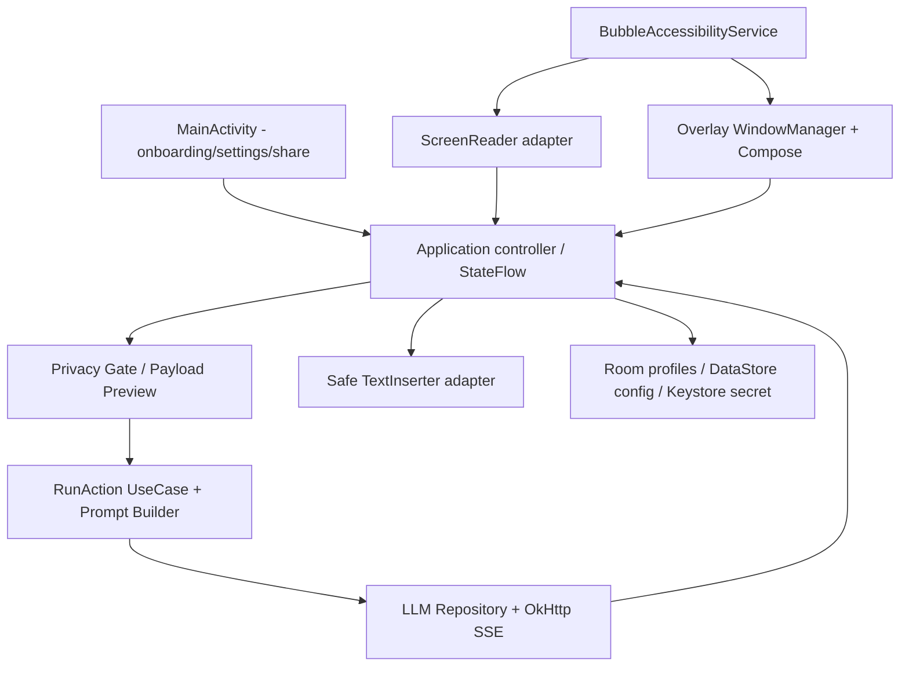

# ARCHITECTURE — BubbleB v0.2

## 1. Architecture decision
Single app process, one `AccessibilityService` providing one accessibility overlay. MainActivity hosts onboarding/settings and Android Sharesheet intake. UDF/MVVM; service is Android boundary and delegates orchestration to application-scoped controller; **do not instantiate an Activity-scoped ViewModel in the service**. No backend required for personal BYOK build. No continuous screen content collection.



## 2. Suggested project tree (directory roles, not required exact class names)

```text
app/src/main/
  AndroidManifest.xml
  java/com/example/bubbleb/
    BubbleBApp.kt
    ui/main/                    # MainActivity; onboarding; settings; provider; app profiles
    ui/overlay/                 # Bubble, panel, results, previews and reusable widgets
    presentation/               # Coordinator/state/events; controllers (not activity-dependent)
    domain/model/               # ScreenContext, ScreenElement, InputSnapshot, AiAction etc
    domain/usecase/             # CaptureContext, SanitizeContext, BuildPrompt, RunAction
    data/llm/                   # Provider schema/client; SSE decoder; DTOs; error mapping
    data/db/                    # Room AppProfile/Persona + DAO
    data/settings/              # DataStore for NON-secret preferences
    data/secrets/               # Android Keystore-backed encrypted key store
    service/                    # BubbleAccessibilityService, ScreenReader, TextInserter
    overlay/                    # OverlayController, lifecycle tree owners and layout logic
    share/                      # Shared text intake Activity/handler
    di/                         # Hilt bindings
  res/xml/accessibility_service_config.xml
app/src/test/                   # pure logic tests, MockWebServer
app/src/androidTest/            # UI / integration where practical
```

## 3. Dependency direction
`UI / service adapters -> application coordinator/use cases -> interfaces -> data implementations`. Domain must not depend on Android View/WindowManager, OkHttp, DataStore or Room. Map platform `Rect` into immutable DTO (`IntRect`). No `AccessibilityNodeInfo` in domain models.

## 4. Components

### BubbleAccessibilityService
- Manifest service with `android.permission.BIND_ACCESSIBILITY_SERVICE`, accessibility intent filter and `res/xml/accessibility_service_config.xml`.
- XML config includes `canRetrieveWindowContent=true`, `feedbackType=feedbackGeneric`, relevant `typeWindowStateChanged` (optionally `typeWindowsChanged` if using retrieval flag), conservative `notificationTimeout`.
- Optional `flagRetrieveInteractiveWindows` **only if needed**; it requires `canRetrieveWindowContent`, and introduces broader access, so avoid by default.
- At `onServiceConnected` initialize access adapter and show overlay only when enabled and foreground not excluded. At events, read only minimal package/window state; never capture text or call LLM from event callback.
- `onInterrupt`, `onUnbind`, `onDestroy`: stop UI, cancel jobs, release references/WindowManager views. Service may be rebound after OS revocation/restart.

### OverlayController
- Own WindowManager `addView/updateViewLayout/removeView` and visibility; strong exception handling for invalid window token and repeated remove.
- `TYPE_ACCESSIBILITY_OVERLAY`, start `FLAG_NOT_FOCUSABLE` and `FLAG_NOT_TOUCH_MODAL` if testing shows appropriate. Do not use blanket `FLAG_LAYOUT_NO_LIMITS` by default.
- Bubble and panel owners are valid ViewTreeLifecycleOwner, ViewModelStoreOwner and SavedStateRegistryOwner when used with `ComposeView`; ensure initialization/restoration order and lifecycle transitions including `ON_CREATE`, `ON_START`, `ON_RESUME`, `ON_PAUSE`, `ON_STOP`, `ON_DESTROY` as applicable.
- Separate panel UI state from service lifecycle. Dispose Compose composition once on teardown. Do not assume service can always keep overlay alive under OEM background restrictions.

### ScreenReader
- `capture()` uses active root; validates package; bounded DFS with visit count/depth/time limits and visible/non-password filtering.
- Returns immutable sanitized transient `ScreenContext`. If uncertain or excluded, typed failure. Do not re-use `AccessibilityNodeInfo` after capture.
- Treat coordinate order as heuristic; never infer exact reply target or participant reliably from screen alone.
- Consider event window metadata stale; root package is authoritative if available.

### PrivacyGate
- P0 preflight: blocked apps, node sensitivity, redaction, size cap, user payload preview and explicit confirmation.
- Stores ephemeral per-request snapshot only in memory, clears on dismiss/app change/service disable. Never logs payload.
- Full screen text only after capture; remote calls **must not happen** before confirmation. When redaction yields mostly empty text, offer cancel or Share.

### RunActionUseCase / PromptBuilder
- Maps enum actions and persona to deterministic system/developer-style instruction, uses controlled template and sandboxed screen text delimiter. No LLM-chosen Android tools.
- User instructions stored for persona must never be silently combined with privileged capabilities; content remains untrusted.
- Reply JSON parser validates max count/length, strips control characters; rejects malformed result for insertion.

### LlmRepository
- Remote `POST /chat/completions` with `Authorization: Bearer ...` via OkHttp request scoped to coroutine lifecycle; no body logging interceptor.
- Normalize user-configured base URL (allow if contains compatible path? define exact path builder and unit test it), reject `http`, embedded credentials, unexpected schemes. SSRF to local/private targets should be blocked in network client where feasible for future shared distribution (personal BYOK still warn).
- SSE parser handles UTF-8 boundaries, multiple `data:` lines, `[DONE]`, arbitrary chunk boundaries and non-stream JSON errors; never parse each network read as one JSON object.
- Streaming cancellation propagates down to OkHttp `Call.cancel`/response close; no leaked sockets. Reply route may use non-stream response; no automatic retry on ambiguous failures.
- Usage metrics only (request count, token counts when returned, error category), in-memory MVP; no prompt/result persistence.

### TextInserter
- User explicitly chooses **Insert**. Reacquire root and focused editable node at action time; validate package, optional window id, freshness and draft text/hash vs input snapshot. No saved platform nodes.
- Prefer safe only-when-empty `ACTION_SET_TEXT` or fully user-confirmed replace. For nonempty input, if reliable selection/cursor action and device support verified, insertion may be enabled behind feature flag; otherwise **Copy only**.
- Avoid implicit clipboard paste because it could replace existing clipboard. `Copy` uses `ClipboardManager` only on direct user tap and may show Android clipboard preview; tell user sensitive text may become accessible through system UI.
- Validate postcondition where possible: success return alone may not guarantee visible target updated; if unverifiable, show warning. Never tap Send.

### Settings repositories
- `DataStore`: bubble position, user choices, non-secret provider metadata, translation language, text caps, consent version and flags.
- `Room`: AppProfile and reusable Persona tables; migration strategy from schema v1 -> v2 if future versions. Scope package visibility to Android package visibility rules; don't require QUERY_ALL_PACKAGES for personal MVP; offer observed-app list or targeted queries.
- `SecretStore`: Android Keystore-backed AES-GCM encrypts provider key; persist ciphertext + IV safely in app-private storage, ciphertext not in plaintext DataStore. Handle locked/invalidation/unavailable key states and re-entry. For prototype, prefer direct AndroidKeyStore API implementation over deprecated/unknown abstractions.

## 5. Domain models (illustrative; contracts may evolve only with documented ADR)

```kotlin
enum class AiAction { REPLY, SUMMARIZE, EXPLAIN, TRANSLATE }
enum class ScreenType { UNKNOWN, CHAT_LIKE, DOCUMENT_LIKE }
enum class ElementRole { TEXT, LABEL, INPUT, UNKNOWN }

data class ScreenElement(
    val text: String,
    val role: ElementRole,
    val bounds: IntRect,
    val order: Int,
    val isEditable: Boolean,
)
data class InputSnapshot(
    val text: String,
    val selectionStart: Int?,
    val selectionEnd: Int?,
    val isPassword: Boolean,
)
data class ScreenContext(
    val packageName: String,
    val appLabel: String,
    val elements: List<ScreenElement>,
    val focusedInput: InputSnapshot?,
    val capturedAtMs: Long,
)
data class ReplyOption(val label: String, val text: String)
```

`ScreenType` is heuristic UI-only; never falsely claim full semantic understanding. Do not persist `ScreenContext` or `InputSnapshot`.

## 6. Panel state machine

```text
Collapsed
  Tap -> Capturing
  Capturing -> Actions | ScreenUnavailable | SensitiveScreenBlocked | PermissionRequired
  Actions -> PreviewConsent (on action selection)
  PreviewConsent -> Loading/Streaming (on explicit send) | Collapsed (cancel)
  Loading/Streaming -> Result | Error | Collapsed (cancel)
  Result -> Copy | InsertConfirm -> InsertingText -> Result/InsertionError
  Any -> Collapsed on dismiss/app switch/service revocation/lock policy
```

State data: action, provider label, context preview sanitized, `requestId`, input snapshot validation metadata, result only in-memory. Ignore stale asynchronous responses if `requestId` or package mismatch. A currently active request must be cancelled before new request.

## 7. Share flow
- `ACTION_SEND` intent filter with `text/plain` (and plain URL as text), `Intent.EXTRA_TEXT`; new task/deeplink handling for app already open.
- Guard against null, nontext, >6,000 code points and untrusted extras. Show preview/consent. Shared text route bypasses accessibility but uses same LLM path.
- Do not request broad storage access.

## 8. Android platform notes
- `TYPE_ACCESSIBILITY_OVERLAY` is an accessibility service window type available before API 26; use minSdk 26 only for chosen support baseline.
- `ACTION_SET_TEXT` replaces full contents and places cursor at end, not a true insert action.
- Accessibility cannot bypass `FLAG_SECURE`, password protections or inaccessible custom rendering.
- `INTERNET` must be explicitly declared in manifest (normal permission; no runtime popup).
- Do not request `SYSTEM_ALERT_WINDOW` for this design; no separate foreground service until empirically necessary and separately scoped.

## 8a. Provider defaults for development (ADR-029)
`app/build.gradle.kts` reads the optional repo-root `.env` and generates `BuildConfig` string fields (`LLM_BASE_URL`, `LLM_API_KEY`, `DEEPSEEK_MODEL`, `QWEN_MODEL`, `DEFAULT_MODEL`, optional `DEEPSEEK_*`/`QWEN_*` direct endpoints) for **debug only**; release fields are empty. `data/config/ProviderDefaults` exposes them read-only. From M3 the provider repository resolves configuration as: user-entered (Keystore) → `.env` debug defaults → unconfigured. Default route is one OpenAI-compatible gateway (CoreWeave Serverless Inference) serving DeepSeek and Qwen models.

## 9. Build gates
- Version pinning via Gradle version catalog (if desired) and stable verified Compose/Kotlin/AGP/Hilt compatibility; record exact versions in build README.
- CI: format/lint, unit tests, build Debug. Nightly instrumented UI tests only if device available; manually run OnePlus matrix.
- Each code/config/test file <=500 physical lines; tracked in AGENTS.md.
